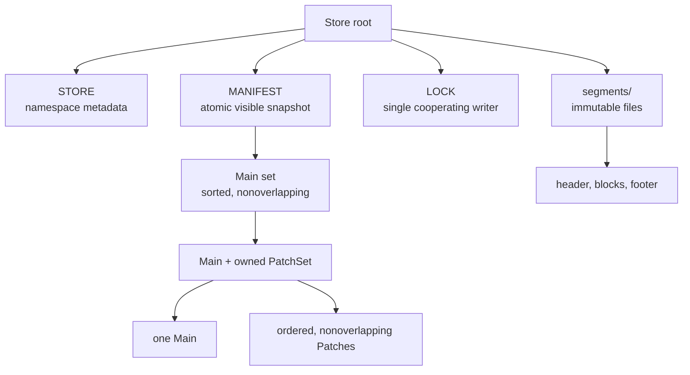

# Architecture

The store separates namespace identity, atomic visibility, immutable segment bytes, and runtime snapshots. Format bytes are specified in [03 Format](03-format.md); path behavior is specified in [04 Operations](04-operations.md).

## Persistent Ownership

`STORE` is written once at creation and holds caller-defined namespace metadata. `MANIFEST` owns the logical schema and is the only source of visible data. Segment files are immutable; directory enumeration never discovers visible records. A replacing manifest publication is the sole visibility transition.

The target MANIFEST represents Main-owned PatchSets canonically: each Main entry directly contains its counted, ordered Patch references. The trusted runtime representation preserves that ownership instead of reconstructing it from parallel tier arrays.

## Runtime Model

Readers take immutable snapshots. A point lookup binary-searches the Main set, then binary-searches the selected Main's PatchSet. It reads at most a healthy Main and one healthy Patch candidate. Range scans concatenate PatchSet segments into one logical ordered patch stream, then two-way merge that stream with the Main stream.

Commits are serialized within a process and by the stable advisory `LOCK` for cooperating processes. Readers of an older snapshot remain valid while a commit creates replacement files and publishes a new manifest. Read-only opens do not take the writer lock and do not mutate the root. Garbage collection is explicit, because deleting retired files can prevent old snapshots from opening their referenced segments.

## Modules

The implementation is organized around persistent concepts rather than horizontal technical layers:

- `record` owns borrowed sorted key/value input shared by block encoders, segment writers, and commit batches.
- `value` owns the store-wide fixed or variable value layout.
- `block` owns one physical read unit, including layout, checksums, compression, encoding, and borrowed decoding.
- `segment` owns one immutable sorted file, including content identity, self-describing header/footer/index codecs, construction, opening, and process-local verification reuse.
- `catalog` owns caller compatibility metadata, manifest visibility, the selected immutable segment view, atomic publication, lifecycle, and garbage collection.
- `snapshot` owns point, ordered, and range reads over one catalog-selected view.
- `commit` owns validated batches, partitioning, replacement planning, normalization, merge, segment production, and one atomic snapshot transition.
- `store` is the public facade and shared state tying catalog, snapshots, and commits together.
- `error`, `binary`, and `key` are small supporting concepts.

Each concept exposes its canonical crate-internal types from the module root. Implementation submodules stay private so internal callers depend on concepts such as `segment::Segment` or `catalog::StoreManifest`, not on incidental files.

## Feature Flags

`ValuePayloadCompressionKind::None` and persisted compression ID `0` remain representable in every build. Compression policy and codec orchestration compile only with the `value-compression` capability; concrete frame implementations require their backend features. A build without the required backend rejects a nonzero unsupported compression ID while opening the segment, before block decoding.

Checksums are not feature-gated. MANIFEST, segment footer, and every block section carry fixed unseeded XXH3-128 digests, while CRC32C protects only the short fixed segment header. Both algorithms are always compiled.

## Process Model

Within one process, `Store` is cheaply cloneable, commits serialize on an internal lock, and readers take immutable snapshots. Segment file I/O for a new commit does not block readers of an older snapshot. Lookup sessions, range cursors, and captured checkpoint snapshots retain their starting segment state and remain valid across later manifest publication.

Across processes, multiple read-only opens may coexist. A writable open holds the stable advisory `LOCK` for its lifetime, and a second cooperating writable open fails with `InputError::WriterLocked`. Read-only opens do not acquire the writer lock or mutate the root. External programs that mutate catalog or segment files without the lock and publication protocol are outside the safety contract.

## Current Implementation Notes

The current pre-release implementation exposes a flat Main tier followed by a Patch tier rather than explicit Main-owned PatchSets. It validates an interval-connected model with at most one patch per component. That wire and runtime model does not yet implement the target ownership, multiple-disjoint-patch, or point-depth contracts.
