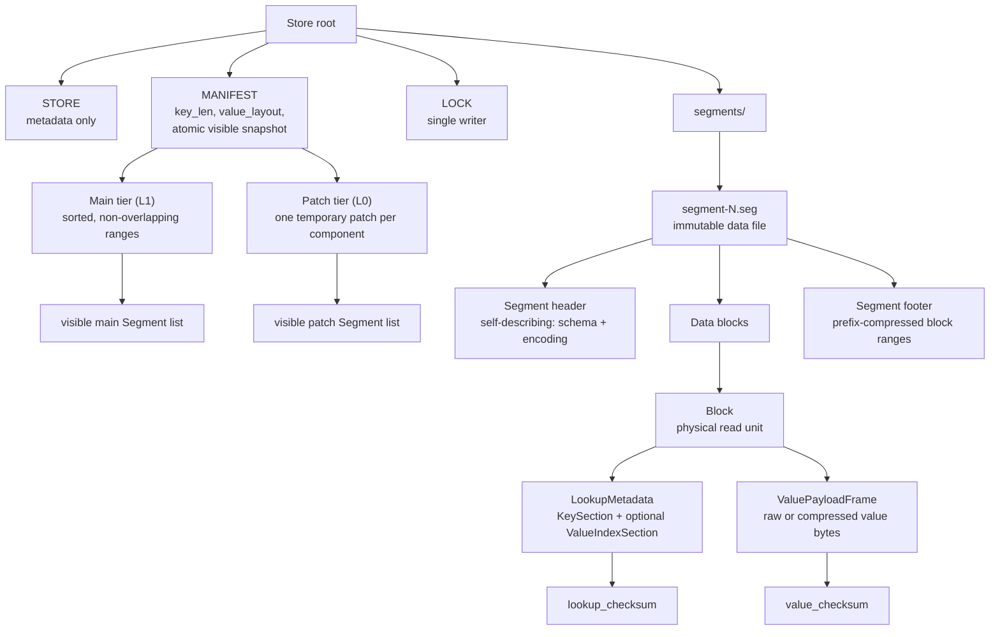

# Architecture

How the implementation is organized: the module map and the process model. On-disk bytes are specified in [03 Format](03-format.md); per-path algorithms in [04 Operations](04-operations.md).

## Module Map

The implementation separates persistent identity, visibility, immutable bytes, and runtime snapshots.

The code is organized around the same persistent concepts rather than horizontal technical layers:

- `record`: borrowed sorted key/value input shared by block encoders, segment writers, and commit batches.
- `value`: the store-wide fixed or variable value layout shared by catalog descriptors, write validation, blocks, and segments.
- `block`: one physical read unit, including layout, checksums, compression, encoding, and borrowed decoding; it does not know segment index entries.
- `segment`: one immutable sorted file, including content identity, self-describing header/footer/index codecs, complete-file writing, opening, and the process-local verification cache.
- `catalog`: caller-defined compatibility metadata, persistent store identity, manifest visibility, the selected immutable segment view, atomic publication, lifecycle, and garbage collection.
- `snapshot`: point, ordered, and range read algorithms over one catalog-selected segment view.
- `commit`: validated write batches, pure replacement planning, segment production, merge, and atomic transition to a new snapshot.
- `store`: the public facade and shared state tying catalog, snapshots, and commits together.
- `error`, `binary`, and `key`: small supporting concepts rather than architectural layers.

Each concept exposes its canonical crate-internal types from the module root. Its implementation submodules stay private, so callers can depend on `segment::Segment` or `catalog::StoreManifest` without reaching into `segment::state` or `catalog::manifest`.

## Feature Flags

Value-payload compression kinds remain available in every build so `None` and persisted id `0` keep a stable public and on-disk representation. Compression policy and codec logic are compiled only with `value-compression`, while concrete frame implementations require their corresponding backend feature. Without those capabilities, catalog and segment parsing reject unsupported non-zero compression ids before block decoding, and blocks use raw-payload paths.

Block checksums are not feature-gated: every block carries the fixed unseeded XXH3 128-bit checksum, and CRC32C is used for fixed catalog and segment structural checks. Both are always compiled in.

## Process Model

Within one process:

- `Store` is cheaply cloneable.
- Readers take immutable runtime snapshots of visible segments.
- Commits serialize on an internal commit lock.
- Commits do file IO without blocking existing readers of older snapshots.
- Lookup sessions and scan cursors remain valid across commits because they hold segment state from their starting snapshot.

Across processes:

- Multiple read-only opens can coexist.
- A writable open holds the advisory `LOCK` file for the lifetime of the store handle.
- A second cooperating writer fails fast with `InputError::WriterLocked`.
- Read-only opens do not take the writer lock, do not run garbage collection, and never mutate the filesystem.
- Segment garbage collection is explicit on writable handles; callers should run it only when they accept that older manifest snapshots may no longer be openable.
- External tools that mutate the root without the lock are outside the safety contract.
