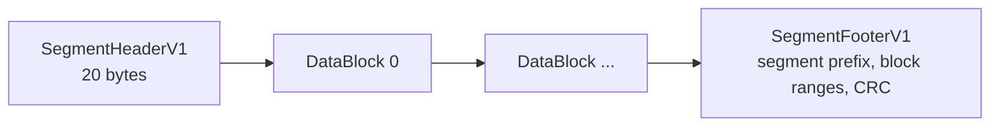

# Format

On-disk bytes. This is the only chapter a second implementation or a format-version review needs to read exhaustively. Behavior built on top of these bytes is in [04 Operations](04-operations.md).

## V1 Implementation Notes

This chapter describes the agreed target model: `STORE` holds only caller metadata, `MANIFEST` owns the logical schema, the block checksum is a fixed store-wide constant, and value-payload compression is a per-segment write-time parameter declared by each segment header. The v1 implementation has not caught up in exactly these places:

- v1 `STORE` additionally persists `key_len`, `value_len`, `block_checksum_id`, and `value_payload_compression_id`; v1 `MANIFEST` persists only `key_len` beside visibility (no `value_len`). The persisted `block_checksum_id` is always the fixed checksum id.
- v1 segment open compares each header's compression id against the store-level compression from `STORE`, so mixed-compression stores are rejected; the schema-match-plus-fixed-checksum rule in this chapter is the target behavior.
- v1 `CommitOptions` does not select compression kinds.

Rebuilding experimental stores is the migration strategy when the target model lands.

## Directory Layout

Each store root contains:

```text
root/
  STORE
  STORE.tmp
  MANIFEST
  MANIFEST.tmp
  LOCK
  segments/
    segment-0000000000.seg
    segment-0000000001.seg
    segment-0000000002.seg.tmp
```

Temporary files are sibling files created by adding a `.tmp` extension to the final path. They are part of atomic publication only. Open and read paths never discover visible data by scanning directories.

`LOCK` is stable and is never atomically replaced, so cooperating writers lock the same inode. `segments/` may contain orphan files after a crash or retired files after replacement commits; they are ignored unless referenced by `MANIFEST` and are removed only by explicit garbage collection. A collection pass stops and returns an I/O error on its first failed deletion; files deleted earlier in the pass remain deleted.

## Store Creation

Creation writes `MANIFEST` first and `STORE` last. `STORE` is the creation completion marker.

This order gives simple crash semantics:

- If creation crashes before `STORE` is written, `Store::open` rejects the root as missing and `Store::create` can safely recreate it.
- If creation completes, both `STORE` and `MANIFEST` exist and ordinary open can proceed.
- A leftover `MANIFEST` from aborted creation is overwritten by the next create attempt.

## Catalog Format

### STORE

`STORE` is line-oriented text, not JSON. Binary metadata is encoded as lowercase hex. It contains only durable namespace identity.

```text
segment-cache-store store v1
version=1
metadata=<hex>
```

`STORE` is the creation completion marker and the namespace identity check. It does not contain schema or encoding information. The logical schema (key length, value layout) is owned by `MANIFEST`. The block checksum is a fixed store-wide constant, and value-payload compression is a write-time parameter declared by each segment's own header.

### MANIFEST

`MANIFEST` is a binary snapshot that owns the logical schema and the visible segment set. Its final CRC32C covers all previous manifest bytes.

```text
magic[4]              # b"SCSM"
version:u32           # 1
key_len:u32
value_len:u32         # 0 = variable, >0 = fixed value length
next_segment_id:u32
segment_count:u32
manifest_entries[segment_count]
crc32c:u32
```

`key_len` and `value_len` together form the logical schema (`StoreSchema`). They define the addressing contract: all manifest min/max keys have width `key_len`, and all visible values conform to `value_len`. Segment open validates that each segment header's schema matches these values. Physical encoding is not stored in the manifest: the block checksum is a fixed constant shared by every segment, and each segment header declares its own compression.

Each manifest entry is:

```text
segment_id:u32
tier:u8               # 0 = main, 1 = patch
segment_len:u64
segment_content_id[32]
min_key[key_len]
max_key[key_len]
```

`segment_id` derives the opaque file name `segments/segment-<id>.seg`. File names do not define key order. `segment_len` enables cheap truncation and bounds checks. `segment_content_id` is `BLAKE3("scs-segment-v1\0" || complete_segment_bytes)` and gives local and future remote storage one stable content identity; it is not an authentication tag, so a remote manifest still requires authentication by its repository or caller.

Manifest entry order is canonical:

- all main-tier entries first, sorted by `min_key`
- all patch-tier entries after main entries, sorted by `(min_key, segment_id)`

Open rejects malformed manifests, duplicate segment ids, invalid key ranges, overlapping main-tier ranges, more than one patch in an interval-connected normalization component, patch entries before main entries, and `next_segment_id` values that could reuse an existing id.

Referenced segments that are missing, malformed, length-mismatched, or inconsistent with their manifest range are dead entries. They are invisible at open time and dropped at the next manifest publication.

## Segment Format

Each segment file contains:

```text
SegmentHeaderV1
DataBlock*
SegmentFooterV1
```



Multi-byte integer fields are little-endian. The first data block starts immediately after the 20-byte header.

The fixed segment header is self-describing: it declares the logical schema and the physical encoding needed to decode the segment. The reader trusts the header after CRC validation and uses its declared values for decoding. The block checksum id is not an encoding choice: it is a fixed discriminant that must name the one store-wide checksum. Only compression varies per segment, and there is no external "expected geometry" comparison for it.

```text
magic[4]             # b"SCSG"
format_version:u8    # 1
block_checksum_id:u8 # 1 = unseeded xxh3-128; other values unsupported
value_payload_compression_id:u8
reserved:u8          # must be 0 in v1
key_len:u32
value_len:u32        # 0 = variable, >0 = fixed value length
header_crc32c:u32    # crc32c over previous 16 bytes
```

The one-byte version and algorithm identifiers are closed v1 discriminants rather than counters. Unknown identifiers are rejected, and a non-zero reserved byte is invalid. The reserved byte keeps the schema fields on a four-byte boundary and leaves space for a future version to define flags without changing the v1 interpretation.

Segment open validates the header as follows:

1. Header CRC passes. If not, the segment is treated as absent (cache miss).
2. Header `key_len` and `value_len` match the manifest's logical schema. If not, the segment is treated as absent.
3. Header `block_checksum_id` equals the fixed store checksum id (`1`), and the `value_payload_compression_id` is supported by this binary's compiled features. If not, the segment is treated as absent.

After these checks, downstream decoding uses the header's own declared compression. The reader does not compare `value_payload_compression_id` against any external expected value. This enables mixed-compression stores after future codec changes or migrations: each segment is decoded according to its own header.

The footer body is variable length because it stores the maximal segment-wide key prefix once and each sparse block-index entry stores an exact range relative to that prefix. Segment-level `min_key` and `max_key` are not repeated here; the manifest entry is their authoritative persisted representation.

```text
segment_prefix_len:u32
segment_prefix[segment_prefix_len]
block_count:u32
block_index_entries[block_count]
footer_body_len:u32  # excludes this field and the CRC
footer_crc32c:u32    # crc32c over footer body | footer_body_len
```

Each block index entry is:

```text
extra_prefix_len:u32
extra_prefix[extra_prefix_len]
min_suffix[key_len - segment_prefix_len - extra_prefix_len]
max_suffix[key_len - segment_prefix_len - extra_prefix_len]
block_offset:u64
```

`segment_prefix` is the maximal common prefix of the manifest minimum and maximum keys. `extra_prefix` is the maximal additional common prefix of each block's relative minimum and maximum. The runtime index owns one shared footer backing allocation plus byte ranges for each component, so it does not allocate a complete prefix per block. Point, ordered, and bounded-range routing compare the three key parts directly without reconstructing either bound. Exact maximum keys also identify gaps between blocks without reading a candidate block.

Block lengths are derived from adjacent offsets; the final block ends at the footer offset obtained from the file trailer. Opening a segment validates range canonicality, strict ordering and non-overlap, manifest min/max agreement, and offset boundaries before materializing byte ranges. Each decoded block must then match the exact indexed prefix, minimum suffix, and maximum suffix. If the header, footer, or block index is invalid, the whole segment is ignored; if an individual block disagrees with its validated index entry, that block behaves as missing data.

Segment encoding is deterministic for the same sorted entries and writer options. This matters for future sync convergence and for stable review of format changes.

## Block Format

Blocks have no separate envelope header or footer. Their byte ranges come from adjacent segment index offsets, while `record_count` is the first field in the checksummed block metadata and owns the geometry required to decode the rest of the block. Variable-value offsets live after `KeySection`, optional value-payload compression metadata lives at the start of `ValuePayloadFrame`, and checksums immediately follow the bytes they protect. Each checksum is the canonical big-endian 16-byte representation of unseeded XXH3-128.

There is no stored `payload_offset` descriptor. The decoder derives the value frame position and decoded payload length from the store value layout:

- `payload_frame_offset = lookup_metadata_len + block_checksum.digest_len`
- variable values: `decoded_payload_len = value_offsets[record_count]`
- fixed values: `decoded_payload_len = record_count * value_len`

`LookupMetadata` is intentionally not just key bytes. For variable values, the offset table is part of lookup correctness because a corrupted offset can make a valid key return the wrong value slice. Blocks have no trailing padding in v1, so the encoded payload ends immediately before `value_checksum`.

`ValuePayloadCompressionKind::None` stores no value frame header: the value payload bytes are stored directly. Compression-capable kinds store a one-byte frame header before each block's payload:

```text
storage:u8           # 0 = raw, 1 = compressed
payload[...]         # extends to the value checksum
```

The segment header determines the compression algorithm; the frame records only whether that block used it or fell back to raw storage. The decoder derives the raw length from the value layout and the stored payload length from the block boundary, so the frame does not duplicate either length. Small or poorly compressible blocks use `storage=0` so the writer does not pay space or decode cost for negative compression. `CommitOptions::value_payload_compression_policy` controls the writer-side thresholds for newly written blocks. The default policy attempts compression only when the raw value payload is at least 64 KiB and keeps the compressed frame only if it saves at least 20%.

Each block first strips the footer-owned segment prefix, then stores only the additional common prefix shared by its first and last relative key. Since records are sorted, both prefixes are shared by every key in the block. The suffix table remains fixed-width, so lookup can binary-search by record index without variable-length key decoding or full-key allocation. Read routing strips prefixes progressively at already-validated range boundaries: snapshot routing compares the full key to select a segment, the segment index compares the remaining relative key to select a block, and record lookup compares only the final suffix. Range scans reconstruct only the current full key by copying the segment prefix, block prefix, and suffix directly into reusable cursor scratch; loaded blocks do not allocate or cache a combined prefix.

Variable-value block layout:

```text
record_count:u32
KeySection:
  extra_prefix_len:u32
  extra_prefix[extra_prefix_len]
  key_suffixes[record_count * (key_len - segment_prefix_len - extra_prefix_len)]
ValueIndexSection:
  value_offsets[record_count + 1]:u32
lookup_checksum      # selected block checksum over record_count | KeySection | ValueIndexSection
ValuePayloadFrame:
  optional frame header
  values...
value_checksum       # selected block checksum over ValuePayloadFrame only
```

Fixed-value block layout:

```text
record_count:u32
KeySection:
  extra_prefix_len:u32
  extra_prefix[extra_prefix_len]
  key_suffixes[record_count * (key_len - segment_prefix_len - extra_prefix_len)]
lookup_checksum      # selected block checksum over record_count | KeySection
ValuePayloadFrame:
  optional frame header
  values[record_count * value_len]
value_checksum       # selected block checksum over ValuePayloadFrame only
```



```mermaid
flowchart LR
  RecordCount["record_count:u32"] --> PrefixLen["extra_prefix_len:u32"]
  PrefixLen --> Prefix["extra_prefix"]
  Prefix --> Suffixes["key_suffixes[]"]
  Suffixes --> Metadata["LookupMetadata"]
  Metadata --> Layout{"value layout"}
  Layout -->|variable| Offsets["ValueIndexSection<br/>value_offsets[record_count + 1]"]
  Layout -->|fixed| NoOffsets["no ValueIndexSection"]
  Offsets --> LookupChecksum["lookup_checksum"]
  NoOffsets --> LookupChecksum
  LookupChecksum --> Payload["ValuePayloadFrame"]
  Payload --> FrameKind{"compression policy"}
  FrameKind -->|none| RawPayload["decoded value payload"]
  FrameKind -->|lz4/zstd| PayloadHeader["frame header<br/>raw or compressed"]
  PayloadHeader --> EncodedPayload["encoded payload"]
  RawPayload --> ValueChecksum
  EncodedPayload --> ValueChecksum
```

For variable values, value `i` is `value_offsets[i]..value_offsets[i + 1]` in the decoded value payload; the last offset is the decoded payload length, so the last value needs no special branch. For fixed values, value `i` starts at `i * value_len` in the decoded value payload.

Block sizing is a writer policy:

- `target_block_size` is a logical split target used while grouping records into blocks
- physical block length is the actual encoded length after metadata, optional compression, and checksums
- existing segments remain readable if future commits use a different target block size because physical block lengths are stored in the block index

## Format Limits

Wire integer widths are not allocation budgets. V1 uses compact `u32` fields where appropriate, while the implementation validates stricter limits before allocating or decompressing untrusted lengths:

- `key_len` is non-zero and at most 64 KiB.
- One value and one decoded block value payload are each at most 64 MiB.
- One encoded block is at most 128 MiB.
- One footer is at most 64 MiB and one segment has at most 1,048,576 blocks.
- One manifest is at most 256 MiB.

Manifest, footer, and block geometry use checked arithmetic, bounded reads, complete-consumption checks, and fallible reservation. These limits are implementation safety boundaries rather than intended operating targets.
