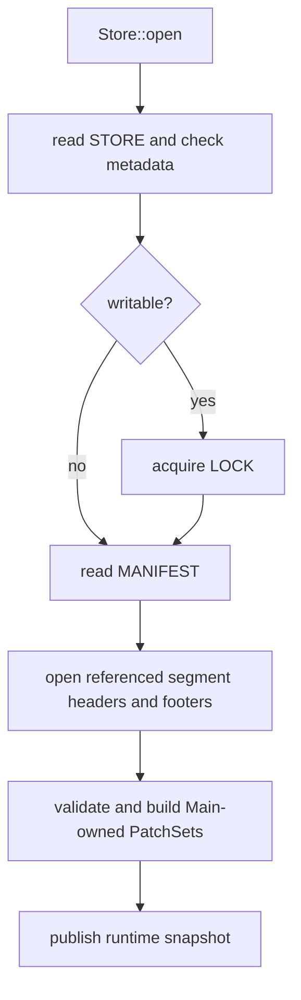
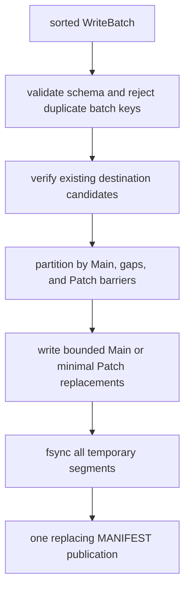

# Operations

## Open And Read

Open validates `STORE` and `MANIFEST` strictly, acquires `LOCK` for writable handles, and opens only manifest-referenced immutable segments. `STORE` and `MANIFEST` failures are hard errors. A referenced segment that is missing or has an invalid length, header, footer, schema, range, or index is absent from the ordinary runtime snapshot; ordinary I/O failures remain hard errors. Block metadata, payload, and decompression failures are discovered lazily and make only the affected block absent.

Segment opening checks file length, header CRC, schema, fixed checksum ID, supported compression, footer CRC, sparse ranges, and index offsets. It does not rescan a locally published complete segment to recompute `SegmentContentId`; that full verification belongs to a trust-boundary operation. Writable opens may remove stale catalog temporary files but do not discover data by scanning `segments/`. Read-only opens never take the writer lock, run garbage collection, or mutate the filesystem.

For a point lookup, binary-search the globally sorted Main ranges. If a Main owns the key range, binary-search its contained PatchSet. At most one healthy Patch and the healthy Main are candidates. A hit exists only after the candidate value payload has fully verified. A healthy Patch supplies a key only where a healthy Main does not; if both abnormally contain it, Main wins.

Ordered lookup validates sorted fixed-width input and preserves input order. It advances through the selected Main and Patch candidates using the sparse block indexes. The low-level visitor returns borrowed slices; owned fetch copies them. Full scan and range scan concatenate the PatchSet into one ordered logical patch stream and two-way merge it with the Main stream. The same merge rule makes a healthy Main win abnormal duplicate keys.

The public ordered APIs are `Store::contains_many_ordered`, `Store::fetch_many_ordered`, `Store::visit_many_ordered`, `Store::lookup_session`, and their `OrderedLookup` counterparts. `fetch_one` exists for completeness but ordered replay is the primary workload. All lookup results retain caller request order, including misses.

Within a segment, ordered lookup consumes every query key belonging to the current block before advancing. It uses exact prefix-compressed block ranges to emit gap misses without loading a block. A complete raw block is read with one positioned read and parsed by offsets. Lookup metadata verifies before a key is considered present; payload verification and decompression occur only if a matching key needs a value. Thus `contains_many_ordered` is cache-safe rather than index-only: presence requires the value payload to verify.

`Store::range(start, end)` and `Store::visit_range(start, end, visitor)` scan half-open `[start, end)` ranges. Equal bounds produce an empty result; `start > end` is an input error detected before segment I/O. `Store::iter_all()` and `Store::visit_all(visitor)` cover the complete snapshot. Iterator and owned fetch APIs allocate for convenience; `visit_*` APIs stream borrowed key and value slices at block granularity. A lookup session or range cursor reuses its block buffer, decoded-payload scratch, codec context, and key scratch.

Verification state is process-local and records only successful metadata and payload checks, so a repeatedly accessed healthy block is not rehashed on every probe. A deterministic failed verification is retried on the next probe until its immutable segment is retired; transient I/O errors are never cached as corruption. Checksum verification can be disabled only for an explicitly read-only benchmarking handle, in which case `contains_many_ordered` no longer has the cache-safe payload-verification guarantee.

## Read-Path Optimizations

The sparse in-memory index has one prefix-compressed range and byte range per block, so open-time memory follows block count rather than record count. Range routing compares prefix parts directly rather than allocating complete bounds. Raw block views keep key metadata, raw payload, and checksum ranges in one backing buffer. Split checksums defer payload work for miss-only probes while protecting variable-value offsets as part of lookup metadata. Positioned reads avoid a shared mutable seek cursor.

## Commit Partitioning And Publication

`WriteBatch` is sorted and duplicate-free. Before publishing, ordinary idempotence filtering verifies the existing payload for each candidate key. A healthy destination key wins and the incoming record is skipped without a value comparison.

`WriteBatch::new`, `WriteBatch::push`, `Store::commit_batch`, `Store::commit_batch_with_options`, `Store::normalize`, and `Store::normalize_with_options` are the public write surface. `CommitOptions` governs newly written block targets, segment chunk limits, and value-payload compression policy; it does not change namespace identity or the fixed checksum. Only validated prepared batches and trusted sorted internal streams reach the segment encoder.

The batch partitioner processes sorted input by Main ownership, gaps, and retained Patch barriers:

- A run in a gap creates bounded Main segment output.
- A run inside a Main but outside its Patch ranges adds a Patch to that Main's PatchSet.
- New keys whose output range would overlap an existing Patch are merged with only the minimally intersected Patch records and replace those touched patches.
- Untouched Patch ranges are hard output barriers. A new or replacement Patch is split before it would cross one, so retained Patch ownership and nonoverlap remain obvious.

When a Main's PatchSet would exceed its hard file or byte budget, foreground normalization rewrites only that Main and its PatchSet into bounded Main segments. It preserves other Main components unchanged. There is no background compaction, no WAL, and no general convergence pass. Main sizing and PatchSet budgets are required but their exact values are TODO.

A gap write does not rewrite an adjacent Main merely to improve fill. This keeps append and disjoint batch publication cheap, but repeated sparse one-record gap commits may create many tiny Main files; that workload is outside the target unless a future explicit convergence policy is added.

The filesystem protocol is: write and fsync each segment temp file, rename completed segment files, fsync `segments/`, then write, fsync, rename, and fsync the new MANIFEST. A crash before manifest publication leaves only invisible temporary or orphan segment files.

> Current implementation note: the current planner uses interval-connected components and permits one direct patch per such component. It has not implemented Main-owned PatchSets, minimal Patch rewriting, retained-Patch barriers, or the target PatchSet budget-triggered normalization policy.

## Replacing Manifest Commit And Atomicity

One atomic MANIFEST snapshot removes zero or more visible references and inserts zero or more new references. Segment thresholds bound newly written output but are not online occupancy invariants: a final small Main is valid, and no commit, normalization, or merge borrows an unaffected neighbor merely to improve fill. One oversized record may exceed a writer chunk target to make progress, but never an absolute format safety limit.

Catalog and segment publication follow the same durable sequence:

1. Write final bytes to a sibling `.tmp` file.
2. Fsync the temporary file.
3. Rename it to the final path.
4. Fsync the parent directory.

MANIFEST is the only visibility point. Garbage collection is explicit writer maintenance: it may delete only files unreferenced by the current manifest, and neither open nor commit scans the directory to discover data. It must not run automatically while a reader might still need a file referenced by an older snapshot.

## Normalization

The unit of normalization is exactly one selected Main and its PatchSet. It concatenates the patches, merges them with Main records, keeps the healthy Main value for an abnormal duplicate, and emits bounded new Main segments. Classified corrupt records are absent; healthy unaffected records survive. It does not rewrite an unrelated Main, even if adjacent output would be small.

Explicit `Store::normalize()` may select every component with patches or dead data, but each unit is planned and streamed independently before one manifest publication. It is useful before a read-heavy phase, export, checkpoint, or remote aggregation. A target-form manifest without patches or dead entries needs no rewrite. Segment production streams records rather than materializing an entire component in one batch. Compression encoders are reused per published segment; lookup and scan decoders reuse per-cursor context and scratch.

## Local Cache Merge

Local merge is destination-biased left union. It consumes the destination first, then sources in explicit stable order, emits each key once, and skips later equal keys without comparing values. For fixed source precedence, it is idempotent and associative; it is not commutative. Tier is not cross-store precedence.

Before planning or reading segment streams, `Store::merge_from` requires equal caller metadata, key length, and value layout; a mismatch is a hard input error and publishes nothing. Segment compression may differ because output uses destination write options and each source segment is self-describing. The merge output observes the same ownership, Patch barriers, Main caps, and PatchSet budgets as a normal commit. It is an ordinary local cache operation, so classified data corruption in destination or sources is absent rather than fatal.

> Current implementation note: the current `merge_from` uses strict conflict semantics and reports `KeyConflict` for different values. It also uses interval-connected retirement and lacks the target destination-biased union and PatchSet barrier planning.

The merge stages and syncs all output segments before its one replacing-manifest publication, so any planning or hard I/O failure leaves the prior destination snapshot visible. Classified data corruption was already omitted by the ordinary input policy. Merging several worker stores should use a single k-way stream and publication when the caller has a stable source order, rather than repeated pairwise merges.

## Explicit Strict Operations

Explicit verify, import, export, checkpoint, and remote aggregation are integrity boundaries. They fail on classified corruption or unexpected visible duplicates rather than treating them as misses. Remote aggregation must not infer precedence from a segment tier; callers provide the ordered source policy.
