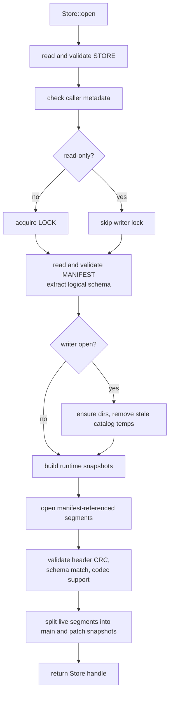
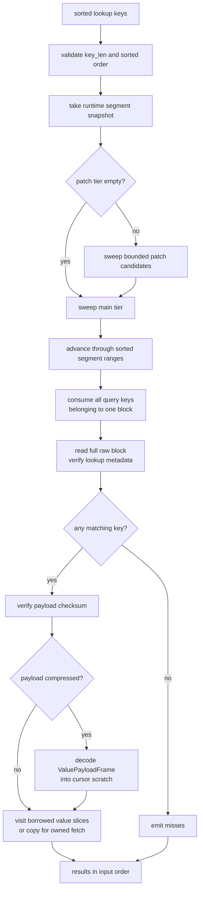
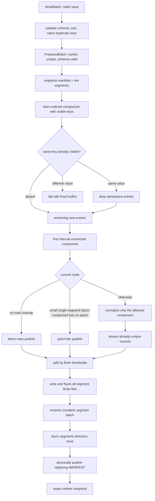

# Operations

The open, read, write, and cross-store merge algorithms, each with the runtime optimizations that serve it. On-disk bytes are in [03 Format](03-format.md); corruption semantics and the trust boundary are in [05 Corruption](05-corruption.md).

## Open Path

Opening a store reconstructs runtime state from the catalog and referenced immutable segments. Directory contents are not used as data discovery.

Malformed `STORE` or `MANIFEST` files are hard open errors because they describe namespace identity and visibility. Manifest-referenced segment failures are not hard open errors: the failed segment is treated as dead miss space, omitted from runtime snapshots, and dropped on the next manifest publication by a writer.

Segment open validates the header CRC, checks that the header's logical schema (key_len, value_layout) matches the manifest's schema, requires the header's block checksum id to equal the fixed store checksum id, and verifies that the declared compression id is supported by this binary. After these checks, the segment's own header values are used for all downstream decoding. There is no store-level "expected geometry" passed through the read path for compression. Each segment is decoded according to its own self-describing header.

> v1 implementation note: v1 open also compares each header's compression id against the store-level compression persisted in `STORE`, so mixed-compression stores are currently rejected.

How much open trusts locally published files — and when the full content verification path runs instead — is part of the trust boundary in [05 Corruption](05-corruption.md).

## Read Path

`fetch_one` exists for completeness. It binary-searches the main tier by range and probes the sole patch candidate for that normalization component when present. Main and patch ranges may both contain the query, but only one may contain the exact key.

Ordered lookup is the hot path:

- `Store::contains_many_ordered`
- `Store::fetch_many_ordered`
- `Store::visit_many_ordered`
- `Store::lookup_session`
- `OrderedLookup::contains_many`
- `OrderedLookup::fetch_many`
- `OrderedLookup::visit_many`

`visit_many` is the lowest-level ordered lookup API. It lets callers consume borrowed value slices, avoiding one `Vec<u8>` allocation per hit. `fetch_many` is a convenience API that copies hits into owned vectors.

When the patch tier is empty, ordered lookup sweeps the main tier directly. When patches exist, it probes the bounded patch candidate for each affected component and then the main tier. An exact key hit can come from only one tier; encountering the same exact key twice is an invariant violation.

Within one segment, ordered lookup reuses cursor state and the last loaded raw block. It uses the exact prefix-compressed block ranges to emit gap misses and consume all query keys belonging to one block before loading another block.

Lookup reads a complete raw block and interprets metadata, keys, and value ranges by offset. If none of the searched keys exist in that block, the reader emits misses without decompressing value payload bytes. If any searched key matches a compressed block, the value payload frame is decoded into cursor-owned scratch before returning a hit. Raw payload frames are borrowed directly from the loaded block bytes.

With default checksum verification, `contains_many_ordered` is cache-safe, not index-only. A key counts as present only if the value payload needed to prove that hit is successfully loaded and verified. If read-only checksum verification is explicitly disabled for benchmarking, this guarantee is intentionally weakened for that open handle.

## Range And Full Scan

`range(start, end)` and `visit_range(start, end)` scan the half-open range `[start, end)`. `iter_all()` and `visit_all()` scan all visible records.

If no patch segments are visible, scan concatenates main-tier segment cursors in manifest order. If patch segments are visible, scan uses a k-way merge across main and patch cursors and rejects duplicate exact keys as an invariant violation.

Scan cursors stream at block granularity. `visit_*` APIs return borrowed slices and do not materialize the full result set. The iterator APIs allocate owned `(Vec<u8>, Vec<u8>)` pairs for convenience.

## Read-Path Optimizations

The implementation optimizes ordered cache replay first, then reduces avoidable work for sparse reads, scans, large values, and repeated passes.

### Sparse In-Memory Block Index

Each segment loads one sparse block index entry per block into memory. Every entry owns one contiguous prefix-compressed minimum/maximum range plus its validated byte range. This keeps open-time memory proportional to block count, not record count, avoids duplicating long common key prefixes, and lets routing compare split keys without allocating full bounds.

### Ordered Block Consumption

Ordered lookup processes all query keys that fall inside the current block before advancing. This avoids reloading or re-searching the same block for locality-heavy ordered streams.

### Borrowed Block Parsing

Blocks are decoded as one owned raw-byte buffer plus derived layout metadata. Raw value frames and key prefix/suffix slices are borrowed directly from that buffer. A range cursor reconstructs only its current full key into one reusable key-sized scratch buffer. Compressed value frames are decoded into a buffer owned by the lookup session or range cursor, and visitor APIs borrow value slices from that buffer. Values are copied only by APIs that return owned vectors.

### Raw Block Views And Lazy Payload Decode

Every accessed block is read from its segment in one contiguous positioned read. The decoder derives and validates key, value-index, payload-frame, and checksum ranges over those raw bytes without materializing values. Ordered lookup probes the uncompressed key metadata first, so a block with no matching key does not decompress a compressed payload. This keeps one backing representation for raw, compressed, lookup, and scan paths while leaving room for a future mmap-backed block buffer.

### Split Block Checksums

Block checksum state is split into lookup metadata and value payload checksums. Metadata verification protects key lookup and, for variable values, the offset table used to locate value slices. Payload verification protects returned value bytes and any value-payload frame header. For fixed-value blocks this is effectively a `KeySection` checksum plus a value-payload-frame checksum; for variable-value blocks it is key-plus-offset metadata versus value payload frame. The reader verifies lookup metadata when a checked block is first loaded, but defers payload verification until a key hit or range scan needs values. Each phase is recorded independently for the lifetime of the immutable segment handle, so misses do not compute payload digests and later checked reads reuse completed verification.

### Process-Local Verification Reuse

Immutable segment blocks keep process-local verification state. Once a block's metadata or payload has passed checksum verification in the current process, later reads of the same part can skip recomputing that checksum. This cache is not persisted and is reset on reopen. Only successful verifications are recorded; a block that fails verification is re-read and re-checked on every probe until its segment is retired.

### Prefix-Stripped Keys

A block stores the common key prefix once and then stores fixed-width suffixes. Ordered lookup compares prefix and suffix slices directly and does not materialize full keys. Each segment range cursor owns one key-sized scratch buffer and reconstructs only the current record key before exposing its borrowed slice.

### Positioned Reads And Buffer Reuse

Segment files are read with positioned reads, so shared file handles do not have a mutable seek cursor. Lookup sessions and scan cursors reuse their previous block buffer when loading the next block.

## Write Path

The public write path is batch-only:

- `WriteBatch::new`
- `WriteBatch::push`
- `Store::commit_batch`
- `Store::commit_batch_with_options`
- `Store::normalize`
- `Store::normalize_with_options`

`CommitOptions` controls newly written segment policy: target block size, max records per segment chunk, approximate max key/value bytes per segment chunk, the patch policy, and value-payload compression (kind and policy). The block checksum is not an option: every segment in every store uses the same fixed checksum. These options are not persistent namespace identity; future commits or explicit normalizations may use different values. Each written segment's header declares the compression actually used, so the reader does not depend on commit-time options.

> v1 implementation note: v1 `CommitOptions` does not select compression kinds; new segments use the store-level compression persisted in `STORE`.

A commit first converts the caller's `WriteBatch` into an internal `PreparedBatch` by validating key/value schema, sorting by key, and rejecting duplicate keys. Under the commit lock, one strict ordered comparison checks the prepared keys against the current visible snapshot. Entries whose existing value is byte-identical are removed as idempotent retries; any differing value fails the whole operation with `InputError::KeyConflict` before segment staging. Only absent keys continue to publication.

Only `PreparedBatch` implements the segment encoder's entry-source contract. Internal normalization and cross-store merge algorithms emit schema-compatible records in strictly increasing key order, so they enter the same representation through a private trusted constructor whose assumptions are checked in debug builds. Administrative write cursors are strict: corruption or a duplicate visible key aborts the operation instead of silently dropping data through read-side corruption-as-miss behavior. The consequences of strict cursors for corrupted segments, and the pending relaxation, are covered in [05 Corruption](05-corruption.md).

The plan chooses one route:

- **Direct main publish** when the batch does not overlap any main-tier segment.
- **Patch publish** when the batch overlaps main-tier data, fits one ordinary segment without an oversized record, satisfies the direct-patch record limit, and its resulting normalization component contains no patch.
- **Normalization** otherwise. It rewrites only the interval-connected component reached from the incoming batch; unrelated patches and main segments remain unchanged.

Normalization and cross-store merge consume sorted records as bounded output chunks. The active chunk is limited by the configured record and byte thresholds, except that one oversized record is allowed to make progress. Existing records from the affected component are streamed through a strict range cursor instead of being materialized into one range-sized batch. Segment thresholds are builder policy rather than online occupancy invariants: a final small segment is valid and normalization does not borrow from or merge with an unaffected neighbor merely to improve fill ratio.

The patch policy is deliberately not an LSM level. At most one patch segment is visible in each normalization component. A second interleaving batch touching that component normalizes it immediately. Disjoint components may each retain one patch, so activity in one key region does not force a rebuild elsewhere. `CommitOptions::with_patch_direct_record_limit` controls the maximum records eligible for direct patch publication; setting it to `0` makes every overlapping commit normalize immediately. The ordinary segment byte threshold is also a hard direct-patch limit, so a single oversized record never becomes a patch.

There is no WAL. A commit writes and syncs all segment temp files, renames the complete batch, syncs the shared `segments/` directory once, and only then publishes `MANIFEST`. Only data referenced by a published manifest is visible. In-progress temp files may be lost, and a crash after any segment rename but before manifest publication can leave orphan segments that remain invisible and are later collected.

## Replacing Manifest Commit

The core write primitive is a replacing manifest publication:

> One atomic manifest snapshot removes zero or more old entries and inserts zero or more new entries.

This primitive supports tail append, gap insert, interleaving writes via one temporary patch per component, local normalization, dead-entry dropping, and segment-count convergence. The replacement must leave the main tier sorted and non-overlapping and must not create a second patch in an existing normalization component.

Normalization is foreground and demand-driven. A segment is rewritten only when a new commit intersects its range and the patch policy requires normalization, or when a caller explicitly invokes `Store::normalize` / `Store::normalize_with_options`. There is no background compaction pass that rewrites cold ranges.

Explicit normalization computes every disjoint patch-connected component, streams each component independently into main-tier output, retains unaffected main segments byte-for-byte, and publishes all replacements with one manifest transition. It is useful before a read-heavy phase or remote publication. If no patch segments or dead entries are visible, explicit normalization is a no-op.

## Unique Keys And Merge Conflicts

The logical store is a partial function from key bytes to value bytes. Segment overlap is an index-routing property and does not permit duplicate logical keys.

- Duplicate keys inside one `WriteBatch` are rejected.
- Recommitting an already-visible key with the same value is an idempotent no-op.
- Recommitting an already-visible key with a different value fails with `InputError::KeyConflict`.
- Cross-store merge collapses byte-identical records and fails atomically on differing values.
- A duplicate key encountered while reading internal merge input is an invariant violation, not a winner-selection opportunity.

This rule does not invent precedence from arrival order, segment tier, or lexicographic value order. If two stochastic computations may legitimately produce different values, their key must encode the seed, replicate, or other identity that makes them different computations.

## Cross-Store Merge

`Store::merge_from` is a phase-boundary snapshot operation, not repeated online insertion. It captures stable source and destination snapshots and publishes one replacement snapshot. Source checksum, structure, or duplicate-key failures abort the operation.

Merge is range-limited: only destination normalization components whose key ranges intersect a source segment's range are retired and rewritten. Destination segments in gaps between source ranges — main and patch — are retained unchanged and are neither read nor rewritten. Merge IO is proportional to the real intersection plus metadata, not to the store sizes. Because retained patches survive, a post-merge destination may still contain patches; this is consistent with the store's invariants, and remote export normalizes into a staged main-only snapshot before upload.

Output segments are cut from the merged record stream by three split triggers: the configured record threshold, the configured byte threshold, and **barriers**. Barriers are the key ranges of every retained destination segment (main and patch), sorted by `(min_key, segment_id)`. Because retirement is component-granular, barriers need not be mutually disjoint: a retained patch overlaps the retained main segments of its own component. No stream record can ever land inside a barrier range, because retained segments are disjoint from the retired-and-merged region by construction; stream records lie entirely to the left or entirely to the right of each barrier. A non-empty output chunk therefore flushes before it would straddle a barrier, which keeps every new main segment disjoint from retained segments and prevents two retained patches from becoming connected through new output into one normalization component.

> v1 implementation note: v1 cuts output chunks by the record and byte thresholds only, so a merge whose output would straddle a retained segment fails loudly at manifest validation (`SegmentOverlap`, or `MultiplePatchesInComponent` across two retained patches) before publication. The destination snapshot is never corrupted by this failure. Barrier splitting is the agreed fix and is tracked in the issue tracker.

For equal keys, byte-identical values are emitted once and differing values return `InputError::KeyConflict`. The implementation stages and syncs every output segment before one replacing-manifest publication, so conflict, corruption, or I/O failure leaves the prior destination snapshot visible. Retired destination files remain until explicit garbage collection.

Source and destination must share the same logical schema (key_len, value_layout). Value-payload compression may differ because output is encoded with the destination's write-time options and each segment's header self-describes its compression; the block checksum is the same fixed algorithm on both sides, so the source stream's forced checksum verification is never vacuous.

Merging several worker stores should use one k-way stream and one publication rather than invoking pairwise merge repeatedly. The first implementation may expose only two-way `merge_from`, but its internal snapshot builder must not rely on arrival order or patch precedence. Remote publication accepts only main-only snapshots; a local store with patches is normalized into a staged export snapshot before upload.

### Merge Invariants

1. **Unique visible keys.** The overlapping region goes through the record-level merge with its conflict rules; retained segments are separated from everything new by barrier splitting.
2. **Main tier globally non-overlapping.** Retained segments are disjoint by definition; new segments never span a barrier.
3. **At most one patch per normalization component.** Barriers include retained patches, so two retained patches can never become connected through new output.
4. **Atomicity.** Every output file is staged and synced before the single manifest replacement; conflicts are detected during streaming, before publication.

### Planned: Source-Segment Adoption

Source main-tier segments that are disjoint from all destination ranges and untouched by source patches are pure inserts, which makes them eligible for byte-level adoption instead of transcoding. The details — including whether adopted bytes are trusted like locally published files or verified through the full single-segment path — are still open and are tracked in the issue tracker rather than specified here.

### Alternatives Considered

- **Block-level byte reuse inside merged regions.** Saves no IO — reused block bytes must still be read and written — and is only conditionally valid, because block bytes embed an `extra_prefix` and fixed-width suffixes whose widths depend on the source segment's prefix. It would also entangle output block sizing with source block boundaries.
- **Retiring by the source's convex hull.** Simpler than barriers (no stream change), but it rewrites destination segments that merely sit inside the hull without overlapping source data, giving back part of the IO saving the optimization exists for.
- **Manifest-level union of segment references.** Cannot prove logical key uniqueness; the record-level merge is required for conflict semantics.

## Atomicity And Filesystem Protocol

Catalog files and segment files use the same publication protocol:

1. write the final bytes to a sibling `.tmp` file
2. `fsync` the temp file
3. rename the temp file to the final path
4. `fsync` the parent directory

For data visibility, `MANIFEST` is the only atomic publish point. A segment file becomes visible only when a later manifest snapshot references it.

Garbage collection is an explicit writer maintenance operation. It scans `segments/` only to delete files not referenced by the current manifest. Directory contents are never used to discover visible data. Open and commit do not run segment GC automatically because read-only opens do not take the writer lock; a reader that already loaded an older manifest must have a chance to open the segment files that manifest references.

## Write-Path Optimizations

### Logical Block Sizing

`CommitOptions::target_block_size` controls how many records are grouped into one block. It is not a physical minimum size. Blocks are written at their actual encoded length, so compressed value payloads can produce much smaller physical blocks while preserving the same logical lookup granularity.

### Optional Value-Payload Compression

Compression is deliberately below the caller codec and above the raw block payload bytes. It never changes keys or value indexes. With a compression-capable `ValuePayloadCompressionKind`, the writer can compress the whole block value payload as one frame and stores raw fallback frames for small or incompressible payloads. `ValuePayloadCompressionPolicy` is a non-persistent commit-time tuning knob: changing it affects future blocks but does not affect the reader contract for existing segments. This centralizes checksum and decompression handling in the storage backend while letting sparse misses avoid decompression.

Compression codecs have process-local contexts. Segment writing creates one value-payload encoder per segment publish and reuses its codec context and compression scratch across all blocks in that segment. A block's raw payload is written directly into the block buffer; it remains there for raw fallback and is replaced only when the compressed representation satisfies the policy. Ordered lookup sessions and range cursors own value-payload decoders and the current decoded payload, so zstd can reuse its decompression context instead of recreating one per block. When a cursor replaces its current block, it reclaims the decoded payload into the decoder's reusable scratch buffer. This keeps the public read contract borrowed while avoiding repeated codec context creation and most repeated compression or decompression buffer allocation.

### Fixed-Value Layout

Stores with fixed-width values can use `CreateOptions::with_fixed_value_len`. Fixed blocks omit the value offset table and compute value ranges arithmetically.
